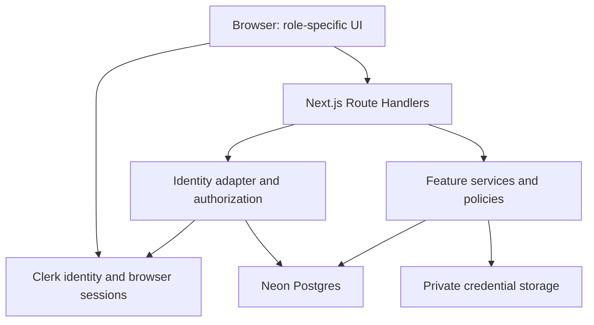

# ShiftPatch Architecture

> Status: proposed application architecture. Implementation and verification are pending.
>
> Scope: the Product Engineer trial brief, `ShiftPatch-Technical-Spec.md`, and the scope committed to the recruiter.
>
> Reviewed: October 16, 2026.

## 1. Purpose and constraints

Build a deployed TypeScript web MVP where agencies post nursing shifts, nurses claim eligible shifts, and an administrator sees coverage and cancellations. The assessment allows seven calendar days and expects approximately eight hours of focused work.

The committed delivery includes the exact sample data, login and shift APIs, posting/claiming/cancelling flows, role permissions, credential expiry checks, all required UI test IDs, focused tests, passing CI, and lightweight credential upload, audit log, and timesheet views.

The supplied technical spec is authoritative for request bodies, response shapes, fixture IDs, error messages, and test IDs. This document defines implementation choices where the packet leaves freedom. These choices can change with evidence; record consequential changes in `docs/decisions.md`.

This is a design for the assessment, not evidence of production healthcare compliance. Uploaded documents and self-reported expiry dates do not establish that a nursing license has been independently verified.

## 2. Stack and decisions

| Concern | Decision | Reason |
| --- | --- | --- |
| Application | Next.js App Router with TypeScript | One codebase and deployment for the React UI and required HTTP API |
| HTTP API | Route Handlers under `src/app/api`, Node.js runtime | Preserve the exact externally tested routes |
| Frontend organization | Feature folders | Keep related UI, schemas, and behavior together |
| Styling | Tailwind CSS with reusable accessible primitives | Consistent UI with limited setup |
| Client server-state | TanStack Query, using a small same-origin API client | Request lifecycle, mutation state, and query invalidation |
| Persistence | Neon Postgres through Prisma | Persistent hosted data, migrations, and transactional writes |
| Validation | Zod at HTTP boundaries | Validate untrusted input at runtime |
| Authentication | Clerk via `@clerk/nextjs` | Managed identity, passwords, browser sessions, and session-token verification |
| Assessment login adapter | Clerk password verification plus bounded ShiftPatch API JWTs using `jose` | Preserve the required email/password-to-JWT endpoint without storing application passwords |
| Credential files | Private Vercel Blob; metadata in Postgres | Separate private document bytes from relational records |
| Tests | Vitest; React Testing Library where useful; Playwright | Rules, real database integration, and browser flows |
| Automation | GitHub Actions and npm scripts | Repeatable checks locally and in CI |
| Hosting | Vercel | Deploy the existing Next.js application |

Next.js supports public HTTP endpoints through Route Handlers [N1]. Neon documents Prisma connectivity [D1]. The feature structure and individual library choices above are project decisions tailored to the assessment.

Use npm consistently with the scaffold already selected. Commit `package-lock.json`, use `npm ci` in CI, and select a supported Node version consistent with installed dependencies. Pin that version in the repository and deployment settings. Check installed Prisma/Next.js versions before copying configuration examples.

## 3. Application boundaries



- Route Handlers are HTTP adapters: parse, validate, identify the actor, call a service, and serialize a result.
- Feature services implement use cases and business rules.
- Prisma queries belong in feature server modules or small repositories that have a concrete purpose.
- Shared server modules contain database configuration, Clerk/assessment-token verification, app-user resolution, and common error mapping.
- Client components cannot import Prisma, token signing code, file-storage credentials, or server modules.
- Use `server-only` at sensitive module boundaries. Treat UI visibility as presentation, never authorization.

Avoid adding generic repository interfaces, dependency-injection containers, or extra layers without a concrete need. Named functions with explicit inputs and a few injectable dependencies are sufficient.

### Planned repository layout

```text
ARCHITECTURE.md
docs/
  ShiftPatch-Technical-Spec.md
  acceptance.md
  decisions.md
src/
  proxy.ts                      # Clerk page integration; middleware.ts on Next.js <=15
  app/
    layout.tsx
    providers.tsx
    login/page.tsx
    nurse/page.tsx
    agency/page.tsx
    admin/page.tsx
    api/
      auth/login/route.ts
      auth/me/route.ts
      auth/logout/route.ts
      shifts/route.ts
      shifts/[id]/claim/route.ts
      shifts/[id]/cancel/route.ts
      agencies/[agencyId]/shifts/route.ts
      credentials/route.ts
      credentials/[id]/file/route.ts
      admin/audit/route.ts
      timesheets/route.ts
  features/
    auth/
      components/login-form.tsx
      hooks/use-app-user.ts
      schemas.ts
      types.ts
      server/clerk-identity.ts
      server/assessment-login.ts
      server/assessment-token.ts
      server/resolve-app-user.ts
    shifts/
      components/
      hooks/
      schemas.ts
      types.ts
      server/shift-service.ts
      server/shift-repository.ts
      server/shift-policy.ts
      server/shift-presenter.ts
    credentials/
      components/
      schemas.ts
      server/
    audit/
      components/
      server/
    timesheets/
      components/
      server/
  shared/
    ui/
    client/api-client.ts
    server/db.ts
    server/session.ts
    server/errors.ts
prisma/
  schema.prisma
  migrations/
  seed.ts
scripts/
  provision-clerk-users.ts
tests/
  integration/
  e2e/
.github/workflows/ci.yml
```

This is a target layout, not a requirement to create empty files or folders. Add each module when its feature needs it. Collocate small unit/component tests with their implementation; use `tests/integration` and `tests/e2e` for broader behavior.

The six required API routes are fixed. All other routes listed above are proposed supporting endpoints.

### Dependency rules

- `app/` composes features and adapts framework requests; features never import from `app/`.
- Feature components depend on their own hooks and public DTOs, plus shared UI/client utilities.
- Feature server services depend on explicit actor/context inputs, policies, and persistence functions.
- Shared modules remain feature-independent. Avoid turning `shared/` into a collection of unrelated business rules.
- Cross-feature calls use named service functions or public types. Do not reach into another feature's internal components or query implementation.
- Keep server and client exports separate; a barrel file must not make server-only dependencies reachable from a Client Component.
- Add a repository wrapper only when it improves query reuse, transaction handling, or testability. Do not wrap every Prisma call mechanically.

## 4. Frontend architecture

Each feature owns its components, hooks, input schemas, public DTO types, and server implementation. Reuse framework-independent types and safe validation code across boundaries; never expose database models as browser contracts.

### State ownership

| State | Owner |
| --- | --- |
| Dialog open state, selected cancellation reason, form fields | Local React state |
| Shift lists, application user profile, audit rows, timesheets | Feature query hooks |
| Roles, ownership, expiry, shift assignment | Server and database |
| Browser sign-in/session lifecycle | ClerkProvider and Clerk SDK hooks; Clerk-managed cookies |
| Assessment API token | Returned only to the direct API caller; no separate browser cookie |
| Required API DTOs | Explicit serializers and TypeScript types |

Use Server Components for page shells and session-aware entry points; put forms, queries, and interactive controls in small Client Components. Shift and credential UI mutations call the actual Route Handlers. The custom browser login form uses Clerk's supported password sign-in flow; the required direct login endpoint has its own contract tests. Both paths resolve the same application user and permissions.

Wrap the app with `ClerkProvider`; compose it with the query provider in the app entry point [C1]. Keep the custom login inputs and submit button so all required login test IDs remain on real controls. Use the sign-in API matching the installed Clerk SDK version, including activation/finalization of a completed session [C2].

Scope query keys by actor and resource. Clear user-specific query state at logout/account changes. After posting, claiming, cancelling, or uploading a credential, invalidate the affected queries. Refetch the visible admin dashboard on focus and at a modest interval; label it as periodically refreshed rather than claiming push-based real-time delivery.

Show loading, empty, success, and error states. Disable duplicate submission while a mutation is pending, but keep server concurrency protection. Reconcile from the server response before displaying a completed claim.

Use semantic forms and tables, associated labels, keyboard-operable dialogs, visible focus, and clear text status indicators. Keep the prescribed `data-testid` values alongside accessible semantics.

## 5. Persistence model

| Model | Minimum responsibilities |
| --- | --- |
| Agency | Fixed agency ID and display name |
| User | Fixed sample ID, unique `clerkUserId`, name, unique email, role, optional agency membership; no password/hash |
| ApiSession | Revocable assessment-token ID, application user, expiry, optional revocation time |
| Credential | Nurse owner, expiry date, optional private file reference, upload metadata |
| Shift | Agency, role, facility-local date/time, status, current claimed nurse |
| Cancellation | Shift, reason, previous nurse, actor, timestamp |
| AuditEvent | Actor, action, resource, timestamp, safe event metadata |
| Timesheet | Assignment reference, planned duration, submission state, nullable actual hours |

Retain seeded expiry eligibility even when a fixture has no uploaded file. File presence is not a new prerequisite for claiming unless the packet is updated.

Use foreign keys and constrained role/status/reason values. Store timestamps for event history, but keep shift `date`, `startTime`, and `endTime` as facility-local calendar values. The packet explicitly requires no timezone conversion.

A lightweight timesheet may show a seeded assignment as “Not submitted,” with actual hours unset. Do not infer that a nurse worked merely because they claimed a shift. If timesheets reference claims over multiple cancellations/reclaims, retain an immutable assignment ID/history rather than attaching all history to the mutable `claimedBy` value.

### Seed invariants

Load the two agencies, two nurses, administrator, credentials, and three shifts exactly as supplied. Agency logins must expose the prescribed agency identity, and nurse/admin logins must expose their prescribed IDs.

| Shift | Agency | Date | Start | End | Status | claimedBy |
| --- | --- | --- | --- | --- | --- | --- | --- |
| shift-1 | agency-a | 2026-10-02 | 19:00 | 07:00 | open | null |
| shift-2 | agency-a | 2026-10-03 | 07:00 | 19:00 | filled | nurse-1 |
| shift-3 | agency-b | 2026-10-04 | 19:00 | 07:00 | open | null |

Provision the five sample identities and exact sample passwords in the dedicated Clerk assessment instance. Keep the fixed local IDs (`agency-a`, `agency-b`, `nurse-1`, `nurse-2`, `admin-1`) and store Clerk's generated ID in a unique `clerkUserId` field. A repeatable administrative provisioning script can set Clerk `externalId` to the fixed local ID and upsert the corresponding mapping [C5].

Clerk owns passwords and their hashes; neither is stored in Neon. Keep public fixture credentials distinct from Clerk secret keys and infrastructure secrets. Provision identities before database fixtures are marked ready; never create users or link identities from an untrusted login request. Do not link accounts by matching a newly submitted email alone.

Make setup seeding repeatable and document any reset behavior. Do not reseed or reset the shared deployed database on every build. Test resets operate only on an isolated test database.

## 6. Exact API contract

All shift responses use this explicit DTO:

```ts
type ShiftDTO = {
  id: string;
  agencyId: string;
  agencyName: string;
  role: string;
  date: string;
  startTime: string;
  endTime: string;
  status: "open" | "filled";
  claimedBy: string | null;
};
```

Serialize date/time values deliberately. Do not spread Prisma rows into responses or accidentally return hashes, private document references, internal metadata, or JavaScript Date strings.

| Method and path | Required behavior |
| --- | --- |
| POST /api/auth/login | Return 200 with `token` and `user: { id, name, role }`; invalid credentials return 401 and `{"error":"Invalid email or password"}` |
| GET /api/shifts | Return `{ shifts: ShiftDTO[] }` across both agencies, including filled shifts |
| POST /api/shifts | Agency creates an open shift in its own agency; return 201 with ShiftDTO |
| POST /api/shifts/:id/claim | Nurse claims an open shift after expiry validation; return 200 with ShiftDTO |
| POST /api/shifts/:id/cancel | Reopen the shift; return ShiftDTO plus `cancellation: { reason, previousNurseId }` |
| GET /api/agencies/:agencyId/shifts | Return `{ agencyId, shifts: ShiftDTO[] }` for the authorized agency |

All authenticated routes support `Authorization: Bearer <token>`. Every API error uses `{ "error": "<message>" }`, including malformed JSON, validation failures, authentication failures, and unexpected errors.

Expired credential rejection is exactly HTTP 403 with:

```json
{ "error": "Credential expired, cannot claim shift" }
```

For unspecified errors, use consistent semantics: 400 invalid input, 401 unauthenticated, 403 unauthorized, 404 missing resource, 409 conflicting shift state, and sanitized 500 for unexpected failures. Test required statuses/messages verbatim.

### Contract details that need deliberate handling

- The GET example omits `shift-3`, but the prose requires all agencies and exact seed data; return all three seeded shifts.
- Agency-list examples abbreviate objects; follow the global requirement for full ShiftDTO objects.
- `shift-7` is an example created ID, not a requirement to hardcode every new shift to that ID.
- Cancellation returns an `open` shift with `claimedBy: null`. Show the cancellation in history; do not substitute a `cancelled` current status.
- Historical fixture dates must remain usable for the specified claim/cancel flows. Do not add a rule that rejects them solely for being in the past.
- Overnight shifts are valid when end time precedes start time. For planned duration, carry the end into the next day.
- Keep dates as date-only values and times as 24-hour strings. Inject a date-only “today” dependency for expiry tests; document the runtime calendar-date policy.

## 7. Authentication and authorization with Clerk

### Ownership and integration

Clerk owns identity, password checks, browser session creation/refresh, and browser sign-out. ShiftPatch owns local roles, agency membership, credential eligibility, and authorization. Every authenticated identity is resolved through the server-controlled `clerkUserId` mapping to a local application user. Clerk IDs must not replace fixed fixture IDs in required API responses.

Use `ClerkProvider` and Clerk's custom email/password flow for the browser, preserving the specified login test IDs [C1][C2]. Configure a dedicated assessment instance where the supplied fixture accounts can complete the required password flow without access to a real email inbox. Check email/password settings, Device Trust, MFA, pending session tasks, and allowed domains before relying on the deployed demo. If a challenge is required, the SDK flow must handle it; do not fake a completed Clerk session or silently alter the required credentials.

Keep local role/agency data authoritative. Do not grant permissions from client-supplied IDs, user-editable metadata, or an unchecked active Clerk Organization. Clerk Organizations are not needed for the two seeded agencies.

### Browser authentication

Clerk manages its own cookies and token refresh. Do not create an application-owned browser session cookie, store password hashes, or persist Clerk tokens in localStorage. Same-origin requests use Clerk's cookie transport; a caller using a Clerk session token explicitly may send it as Bearer [C3]. Do not assume Clerk's app-domain session cookie is HttpOnly or copy the old custom-cookie design.

Use Clerk SDK authentication at each page/resource boundary, then resolve the local actor and enforce domain permissions. Page redirects are appropriate for browser navigation; APIs must return the required JSON errors [C6]. Clear user-specific query caches on sign-out or identity changes. Sign-out uses Clerk's supported session lifecycle rather than manually deleting Clerk cookies.

### Preserve POST /api/auth/login

The assessment requires an unauthenticated `{ email, password }` request returning `{ token, user: { id, name, role } }`. A prebuilt Clerk SignIn component, redirect, sign-in ticket, or existing-session token endpoint does not replace that contract.

Clerk's Backend SDK `users.verifyPassword({ userId, password })` verifies a password and returns `{ verified: true }`; it does not create a Clerk browser session or return a session JWT [C4]. Do not invent a server-side session-creation method or return `verified: true` as the login result.

**Chosen compatibility design:** use a narrowly scoped assessment login adapter. Clerk verifies the password; ShiftPatch issues a short-lived, revocable API JWT solely to preserve the fixed contract. This adapter is a project decision, not a Clerk-recommended replacement for a complete production sign-in flow.

1. Validate the body and resolve only a provisioned, enabled assessment account to its local ID and `clerkUserId`.
2. Check Clerk account availability and reject banned/locked accounts and accounts requiring additional factors. The adapter is not a general bypass for MFA, Device Trust, or other Clerk policies; its permitted account/policy scope must be explicit in the dedicated assessment instance.
3. Verify the supplied password through Clerk's Backend SDK. Never compare against a hardcoded password or a second application hash.
4. On a credential mismatch or unknown account, return the exact 401 `{"error":"Invalid email or password"}`. Map provider outages/rate limits to sanitized JSON service errors; do not report a successful login when Clerk fails.
5. Create an `ApiSession` and sign a bounded-lifetime JWT, for example 15 minutes, with a distinct ShiftPatch issuer, API audience, local subject, unique session ID, and expiry.
6. Return the exact required shape, with `token` containing this ShiftPatch API JWT and `user` containing the fixed local ID/name/role. Never label the token a Clerk session JWT or activate it in Clerk's browser SDK.

This keeps `jose` only for the compatibility token. Remove `bcryptjs` and local password hashing. Enforce persistent/shared throttling on this public password-checking endpoint; do not assume Clerk's frontend protections cover an application-created endpoint.

### Protected API guard and token boundaries

Every protected Route Handler calls one shared guard and receives a normalized local actor, regardless of token transport:

| Request | Verification | Local identity |
| --- | --- | --- |
| Same-origin Clerk session cookie | Clerk Backend SDK request authentication | Map verified Clerk user ID to the local user |
| Bearer Clerk session token | Clerk's supported session-token verification with configured issuer/authorized parties | Map verified Clerk user ID to the local user |
| Bearer assessment API token | `jose` with fixed ShiftPatch issuer/audience/algorithm/key, plus active `ApiSession` and local-user checks | Resolve the signed local subject and its Clerk mapping |

Inspecting an unverified token may select a validator; it never establishes identity. Each validator must fully verify its own trust boundary. Reject unknown issuers, invalid signatures, expired/revoked tokens, and missing mappings. An explicitly supplied invalid Bearer token must not fall back to a valid cookie or another validator after failure.

Scope `clerkMiddleware()` to the page and Clerk-integration routes that need it. Let the custom API guard own `/api` authentication so Clerk middleware does not preempt a compatibility token with a redirect, handshake, or mismatched error response. The API guard uses Clerk Backend SDK `authenticateRequest()` directly for Clerk credentials [C8]; it must not call a middleware-dependent helper on paths excluded from middleware. Validate this routing against the installed SDK.

For pages, use `src/proxy.ts` on Next.js 16+ or `src/middleware.ts` on older supported versions [C1]. Do not blindly copy a matcher that forces every API request through Clerk protection. Do not use `auth.protect()` defaults where their response status/shape conflicts with the packet; explicitly return `{ error }` and the required status [C6]. Apply appropriate Origin/CSRF checks to cookie-authenticated mutations.

Clerk browser sign-out does not revoke an assessment API token. API logout revokes its `ApiSession`; other Clerk account/session changes do not automatically revoke that token without synchronization. Document the bounded lifetime and this separate revocation behavior. Do not claim provider-wide revocation is implemented unless it is actually connected.

Server-side authorization remains mandatory even after authentication and page/layout checks [N2].

### Proposed permission policy

These rules fill gaps in the packet and must be recorded as assumptions:

| Operation | Nurse | Agency | Admin |
| --- | --- | --- | --- |
| Read marketplace shifts | Yes | Yes | Yes |
| Create a shift | No | Own agency | No additional capability required |
| Claim a shift | Self, valid expiry | No | No |
| Cancel in advance | Own claim | Own agency's filled shift | Any filled shift |
| Record no-show | No | Own agency's filled shift | Any filled shift |
| Read agency-scoped shifts | No | Own agency only | Any agency |
| Upload credential | Self only | No | No additional capability required |
| Read audit log | No | No | Yes |
| Read timesheets | Own assignments | Own agency's assignments | All |

Credential upload changes the demo's self-reported eligibility; it is not a license verification or approval system. Document this trust assumption and the production need for independent verification.

## 8. Transactional shift changes

### Claim

1. Authenticate the actor and require a nurse.
2. In a short transaction, read the nurse's effective credential and validate expiry.
3. Conditionally update the target shift only where it is still `open` and unclaimed.
4. If no row changes, return the appropriate missing-resource or conflict error.
5. Persist assignment/audit history within the same transaction.
6. Return the serialized updated shift.

Use a real database conditional write/locking strategy. A read followed by an unconditional update can assign the same shift twice. If using serializable transactions, implement bounded retries for the provider's retryable conflicts. Keep external file/network calls out of transactions [D2].

Treat expiry as valid through its date unless clarification says otherwise; test the day before, on, and after the boundary.

### Cancellation

Authorize the actor against the current assignment and agency. Within one transaction, conditionally reopen the filled shift, preserve the previous nurse in a cancellation record, and append an audit event. Reject duplicate/conflicting cancellation attempts.

A claim/cancel transaction either persists its state change and audit history together or rolls back both. Client button state cannot enforce this invariant.

## 9. Credential files, audit, and timesheets

### Credential upload

Authenticate ownership, enforce a modest documented size limit, allow only supported document types, and validate bytes where practical. Generate server-side storage names rather than trusting uploaded paths. Store the file privately; serve downloads through an authorized endpoint. Keep file metadata and expiry in Postgres [F1].

Object storage and Postgres do not share a transaction. If metadata persistence fails after upload, attempt deletion of the new blob. When replacing a file, commit the new reference before removing the old blob. Report cleanup failures without leaking document contents.

### Audit

Record actual successful business events, with actor, resource, action, and timestamp. Never log passwords, Bearer tokens, raw documents, or connection strings. Serve a recent, bounded admin view; clients cannot submit fabricated audit entries.

### Timesheets

Deliver a real view of assignments and submission state. Distinguish planned duration from recorded work. Editing/approval/payroll workflows are deferred unless the core delivery is complete. Display a clear empty state when there are no entries; do not create fictional worked hours.

## 10. Required UI automation surface

Attach each exact test ID to the real element, not an invisible placeholder.

| data-testid | Required element |
| --- | --- |
| login-email-input | Login email input |
| login-password-input | Login password input |
| login-submit-button | Login submit button |
| shift-list-item | Each shift card/row in the open-shifts list |
| shift-claim-button | Claim action inside the relevant shift |
| shift-cancel-button | Cancellation action for a claimed shift |
| credential-upload-input | Credential file input |
| credential-expiry-date-input | Credential expiry input |
| agency-post-shift-button | Opens the new-shift form |
| agency-post-shift-submit-button | Submits the new-shift form |
| admin-dashboard-shift-table | Admin reporting table |
| admin-shift-status-badge | Current status on each admin shift row |
| audit-log-table | Actual audit listing |
| timesheet-table | Actual timesheet/assignment view |
| notification-banner | Success and error confirmation, distinguished by content |

Preserve IDs during refactors. Repeated row IDs are intentional where specified; scope action locators to the relevant row.

## 11. Verification and CI

### Test the behavior that carries risk

| Layer | High-value checks |
| --- | --- |
| Unit | Expiry boundaries, overnight duration, serializers, cancellation policy |
| Database/API integration | All six contracts; wrong role/agency; invalid Clerk or assessment JWT; missing identity mapping; expired nurse; claim/cancel transitions |
| Clerk boundary | Real fixture sign-in; exact direct-login contract; invalid password; cookie/Bearer parity; API-token expiry/revocation; JSON errors despite middleware |
| Concurrency | Two simultaneous valid claims produce one assignment and one success |
| Browser | Agency posts; Maria claims; James is rejected; cancellation reopens; admin sees state and history |
| Supporting UI | File/expiry controls work; audit/timesheet tables show real data or clear empty states |
| Live smoke | Public URL opens, seeded login works, one main flow persists across reloads |

Use isolated Postgres for integration tests, preferably an ephemeral CI service. Stub Clerk at a narrow identity/password-verification boundary for deterministic service tests, and separately exercise real Clerk login and token verification in a dedicated deployed test instance. Do not claim provider integration was verified from mocks alone. Mock external blob operations at the storage boundary for automated tests; perform one authorized deployed upload/download smoke check. Do not claim concurrency correctness from a mocked repository test.

Browser tests mutate data. Give each test an isolated setup or serial reset strategy; never run destructive resets against the evaluator's shared deployment.

### Planned commands

Configure these scripts before citing them as available:

```bash
npm run typecheck
npm run lint
npm run test:unit
npm run test:integration
npm run test:e2e
npm run build
npm run verify
```

`verify` runs the defined typecheck/lint/unit/integration gates and fails on any failure. Build and browser tests are explicit additional CI/release gates. Use the same scripts locally and in CI; no success masking, skipped assertions, or disabled rules to produce green output.

The workflow installs locked dependencies, provisions test Postgres, applies test migrations/fixtures, runs checks, builds, and runs Playwright. Keep test reports on failure. Review dependency/security findings and fix material issues within scope; disclose concrete remaining risks.

After a small change, run the tests relevant to that change. Run the complete required gates before delivery. Avoid repeatedly rerunning unrelated suites without a concrete risk to resolve.

## 12. Deployment and operational boundaries

Deploy a minimal working version early. Use server-only environment variables for the database, `CLERK_SECRET_KEY`, assessment API JWT signing secret, and private blob token. Keep secrets out of browser bundles, git history, and build logs. `NEXT_PUBLIC_CLERK_PUBLISHABLE_KEY` is intentionally public and belongs to the same Clerk instance as the server secret.

Configure Clerk sign-in/sign-out URLs, allowed origins, and the deployed domain for the selected instance. Development and production Clerk instances are separate; provision and map the fixture users in the actual evaluator instance. Do not assume local/development users transfer automatically or that production domain setup works on an arbitrary preview URL [C7].

Validate native Clerk browser login and the direct API login from the final public URL before building the remaining flows. A dedicated test/demo instance contains only synthetic assessment users; document the selected instance and its limitations. Fail closed for unmapped users and use Clerk-backed passwords throughout.

Use a pooled database connection appropriate to the installed Prisma/Neon setup. Run reviewed migrations deliberately; do not run destructive migration/reset commands against the shared app [D1].

The public deployment must be reachable without developer platform authentication. App login remains required for protected features. Run the final smoke check in a fresh browser session and give reviewers the supplied sample accounts.

Defer email delivery, bulk inspector exports, PostHog, advanced reporting, push updates, payroll/approval workflows, and production credential verification unless the committed core is complete. Explain these limits plainly.

### Build sequence

1. Acceptance matrix and feature boundaries.
2. Next.js scaffold, database schema/fixtures, first public deployment.
3. Clerk fixture provisioning, browser sign-in, direct-login compatibility adapter, and exact login/listing/posting contracts.
4. Atomic claim/cancel behavior with authorization and integration tests.
5. Main role-specific UI with required test IDs.
6. Functional lightweight credential, audit, and timesheet views.
7. CI, browser/security checks, deployed smoke test.
8. Final deployment validation and documented limitations.

A stage is complete when the behavior is observed and its required checks pass. If the time budget is exhausted, preserve a runnable core and document partial features clearly.

## 13. Sources and attribution

Challenge sources: the supplied `Designli Trial Challenge - Product Engineer.pdf`, `ShiftPatch-Technical-Spec.md`, and the scope email sent to the recruiter. Keep the supplied technical spec unchanged in `docs/`; do not replace it with this summary.

Official guidance checked on October 16, 2026:

- **[C1] Clerk: Next.js App Router quickstart.** [Documentation](https://clerk.com/docs/nextjs/getting-started/quickstart)
- **[C2] Clerk: Custom email/password authentication flow.** [Documentation](https://clerk.com/docs/guides/development/custom-flows/authentication/email-password)
- **[C3] Clerk: Making authenticated requests.** [Documentation](https://clerk.com/docs/guides/development/making-requests)
- **[C4] Clerk: Backend password verification.** [Documentation](https://clerk.com/docs/reference/backend/user/verify-password)
- **[C5] Clerk: Provisioning users and external identity mapping.** [Documentation](https://clerk.com/docs/reference/backend/user/create-user)
- **[C6] Clerk: Protecting pages and Route Handlers.** [Documentation](https://clerk.com/docs/nextjs/guides/secure/protect-content)
- **[C7] Clerk: Development and production instances.** [Documentation](https://clerk.com/docs/guides/development/managing-environments)
- **[C8] Clerk: Backend request authentication.** [Documentation](https://clerk.com/docs/reference/backend/authenticate-request)
- **[N1] Next.js: Backend for Frontend.** [Documentation](https://nextjs.org/docs/app/guides/backend-for-frontend)
- **[N2] Next.js: Authentication.** [Documentation](https://nextjs.org/docs/app/guides/authentication)
- **[D1] Neon: Connect from Prisma to Neon.** [Documentation](https://neon.com/docs/guides/prisma)
- **[D2] Prisma: Transactions.** [Documentation](https://www.prisma.io/docs/orm/fundamentals/transactions)
- **[F1] Vercel: Private Blob storage.** [Documentation](https://vercel.com/docs/vercel-blob/private-storage)

Provider-specific options may change. Resolve syntax against the installed versions when implementing. Update this document when an architectural decision changes; keep short-lived progress in commits and acceptance notes.
