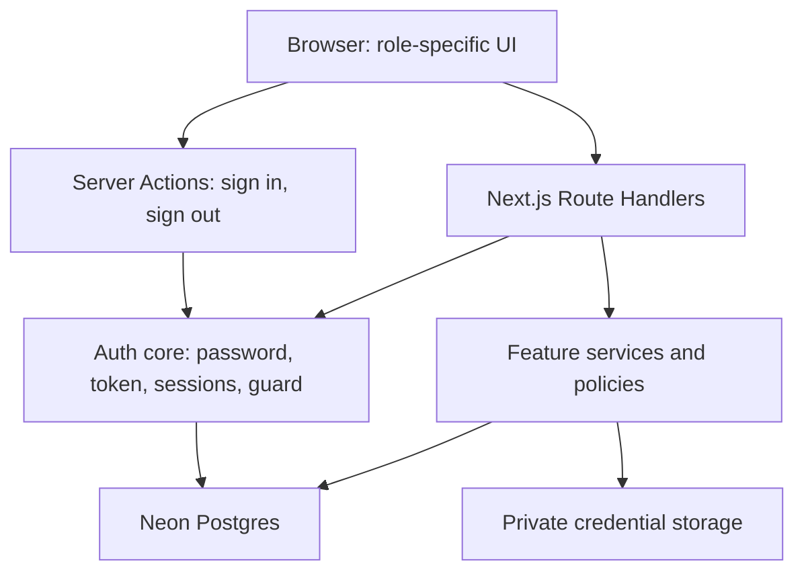

# ShiftPatch Architecture

> Status: proposed application architecture. Implemented so far: the Neon database foundation, authentication (§7, §12), shift listing and posting (§3, §5, §6), claiming a shift with credential expiry and audit (§3, §5, §6, §8), cancelling a filled shift or recording a no-show (§3, §5, §6, §8), and the admin shift overview (§3, §4). Credential upload, the audit view and timesheets are pending.
>
> Scope: the Product Engineer trial brief, `ShiftPatch-Technical-Spec.md`, and the scope committed to the recruiter.
>
> Reviewed: October 16, 2026.

## 1. Purpose and constraints

Build a deployed TypeScript web MVP where agencies post nursing shifts, nurses claim eligible shifts, and an administrator sees coverage and cancellations. The assessment allows seven calendar days and expects approximately eight hours of focused work.

The committed delivery includes the exact sample data, login and shift APIs, posting/claiming/cancelling flows, role permissions, credential expiry checks, all required UI test IDs, focused tests, passing CI, and lightweight credential upload, audit log, and timesheet views.

The supplied technical spec is authoritative for request bodies, response shapes, fixture IDs, error messages, and test IDs. This document defines implementation choices where the packet leaves freedom. These choices can change with evidence; record consequential changes in `docs/decisions.md`.

This is a design for the assessment, not evidence of production healthcare compliance. Uploaded documents and self-reported expiry dates do not establish that a nursing license has been independently verified.

## 2. Stack and decisions

| Concern | Decision | Reason |
| --- | --- | --- |
| Application | Next.js App Router with TypeScript | One codebase and deployment for the React UI and required HTTP API |
| HTTP API | Route Handlers under `src/app/api`, Node.js runtime | Preserve the exact externally tested routes |
| Frontend organization | Feature folders | Keep related UI, schemas, and behavior together |
| Styling | Tailwind CSS with reusable accessible primitives | Consistent UI with limited setup |
| Client server-state | Proposal: TanStack Query, deferred until a view needs polling or cross-view invalidation. The agency board renders on the server and refreshes with `router.refresh()` after a mutation, through a small same-origin API client. The admin shift overview is also a Server Component: it refreshes through `useServerRefresh` from its Refresh button and when the browser tab becomes visible again, with no timer | Request lifecycle, mutation state, and query invalidation once more than one view shares shift data |
| Persistence | Neon Postgres through Prisma | Persistent hosted data, migrations, and transactional writes |
| Validation | Zod at HTTP boundaries | Validate untrusted input at runtime |
| Authentication | Self-managed: `node:crypto` scrypt password hashes, HS256 JWTs signed with `jose`, revocable `ApiSession` rows | One token serves both the required email/password-to-token endpoint and the browser, with no second identity provider (§7, `docs/decisions.md`) |
| Credential files | Private Vercel Blob; metadata in Postgres | Separate private document bytes from relational records |
| Tests | Vitest; React Testing Library where useful; Playwright | Rules, real database integration, and browser flows |
| Automation | GitHub Actions and pnpm scripts | Repeatable checks locally and in CI |
| Hosting | Vercel | Deploy the existing Next.js application |

Next.js supports public HTTP endpoints through Route Handlers [N1]. Neon documents Prisma connectivity [D1]. The feature structure and individual library choices above are project decisions tailored to the assessment.

**Implemented (2026-10-16): database driver.** The app reaches Neon through node-postgres (`pg`). `src/shared/server/db.ts` holds one lazily created `Pool` over the pooled `DATABASE_URL`, imports `server-only`, and registers the pool with `attachDatabasePool` from `@vercel/functions`. Neon's agent guidance recommends that combination for Vercel Fluid compute [D3]; off Vercel the call does nothing. **Implemented (2026-10-17):** `getPrisma()` in the same file builds the Prisma client on that pool through `@prisma/adapter-pg`, so the app opens one connection set. `prisma`, `@prisma/client` and `@prisma/adapter-pg` are pinned to 7.10.1; npm's `latest` tag for `prisma` points at an 8.0 release candidate, which does not match the client. The generated client lives in `src/generated/prisma` (gitignored, regenerated by `postinstall`).

Use pnpm (`packageManager` pins 10.27.0) and commit `pnpm-lock.yaml`. CI (TD-2) will install with `pnpm install --frozen-lockfile`. Node is pinned in `.nvmrc` (24.16.0). Check installed Prisma and Next.js versions before copying configuration examples.

## 3. Application boundaries



- Route Handlers are HTTP adapters: parse, validate, identify the actor, call a service, and serialize a result.
- Feature services implement use cases and business rules.
- Prisma queries belong in feature server modules or small repositories that have a concrete purpose.
- Shared server modules contain database configuration (`db.ts`) and common error mapping (`errors.ts`). Token verification and session resolution live in `features/auth/server/`.
- Client components cannot import Prisma, token signing code, file-storage credentials, or server modules.
- Use `server-only` at sensitive module boundaries. Treat UI visibility as presentation, never authorization.

Avoid adding generic repository interfaces, dependency-injection containers, or extra layers without a concrete need. Named functions with explicit inputs and a few injectable dependencies are sufficient.

### Planned repository layout

```text
ARCHITECTURE.md
docs/
  ShiftPatch-Technical-Spec.md
  acceptance.md
  decisions.md
src/
  proxy.ts                      # implemented: optimistic page redirects (Next.js 16 proxy)
  app/
    layout.tsx
    providers.tsx
    login/page.tsx              # implemented
    (workspace)/
      admin/                    # implemented: sidebar shell and shift overview
        layout.tsx
        page.tsx                # reads every shift and every agency from the database
        error.tsx               # inline error with "Try again" (retry())
      nurse/                    # implemented: sidebar shell, marketplace, claim and My shifts UI
      agency/                   # implemented: sidebar shell and shift board UI
        layout.tsx
        page.tsx                # implemented: reads the agency's shifts from the database
    api/
      auth/login/route.ts       # implemented
      auth/me/route.ts          # implemented (proposal, not a spec route)
      auth/logout/route.ts      # implemented (proposal, not a spec route)
      health/route.ts           # implemented: database reachability (proposal, not a spec route)
      shifts/route.ts           # implemented: GET list, POST create
      shifts/[id]/claim/route.ts            # implemented
      shifts/[id]/cancel/route.ts           # implemented
      agencies/[agencyId]/shifts/route.ts   # implemented
      credentials/route.ts
      credentials/[id]/file/route.ts
      admin/audit/route.ts
      timesheets/route.ts
  features/
    auth/                       # implemented
      actions.ts                # signIn / signOut Server Actions
      components/login-form.tsx
      constants.ts
      schemas.ts
      types.ts
      workspace.ts              # role -> workspace path; imported by the proxy
      server/password.ts
      server/token.ts           # no Prisma import; the proxy uses it
      server/sessions.ts
      server/login.ts
      server/request-auth.ts    # requireActor / requireSession
      server/current-user.ts    # getCurrentUser / requireRole for pages
    shifts/                     # listing, posting, claiming and cancelling implemented
      components/               # implemented: the agency board and post-a-shift dialog
      schemas.ts                # implemented: newShiftSchema and cancelShiftSchema, shared by the dialogs and the API
      types.ts                  # implemented: ShiftDTO, CancelledShiftDTO, AgencyShift, CANCELLATION_REASONS
      schedule.ts               # implemented: display helpers
      server/shift-service.ts   # implemented: Prisma calls live here, no repository layer
      server/shift-policy.ts    # implemented: canPostShift, canReadAgencyShifts, canClaimShift, credentialClaimError, canRecordNoShow, cancellationRefusal
      server/shift-presenter.ts # implemented: toShiftDTO and toCancelledShiftDTO, explicit serializers; the only place that maps the database's `no_show` to the API's `"no-show"`
    credentials/
      status.ts                 # implemented: getCredentialStatus, todayIsoDate
      components/               # implemented: credential banner
      schemas.ts
      server/credential-service.ts   # implemented: getCredentialExpiry reads the Credential table
    audit/
      components/
      server/audit-service.ts   # implemented: recordAuditEvent, transaction client only
    timesheets/
      components/
      server/
  shared/
    ui/
    client/api-client.ts        # implemented: apiFetch
    server/db.ts                # implemented
    server/errors.ts            # implemented
    server/http.ts              # implemented: readJson
prisma.config.ts                # implemented
prisma/
  schema.prisma
  migrations/
  fixtures.ts
  seed.ts
  branch-guard.ts               # refuses writes unless NEON_BRANCH=dev
tests/
  integration/                  # implemented: runs on the Neon dev branch
  unit/
e2e/                            # Playwright specs
.github/workflows/ci.yml
```

This is a target layout, not a requirement to create empty files or folders. Add each module when its feature needs it. Collocate small unit/component tests with their implementation; use `tests/integration` and `tests/e2e` for broader behavior.

The six required API routes are fixed. All other routes listed above are proposed supporting endpoints.

### Dependency rules

- `app/` composes features and adapts framework requests; features never import from `app/`.
- Feature components depend on their own hooks and public DTOs, plus shared UI/client utilities.
- Feature server services depend on explicit actor/context inputs, policies, and persistence functions.
- Shared modules remain feature-independent. Avoid turning `shared/` into a collection of unrelated business rules.
- Cross-feature calls use named service functions or public types. Do not reach into another feature's internal components or query implementation.
- Keep server and client exports separate; a barrel file must not make server-only dependencies reachable from a Client Component.
- Add a repository wrapper only when it improves query reuse, transaction handling, or testability. Do not wrap every Prisma call mechanically.

## 4. Frontend architecture

Each feature owns its components, hooks, input schemas, public DTO types, and server implementation. Reuse framework-independent types and safe validation code across boundaries; never expose database models as browser contracts.

### State ownership

| State | Owner |
| --- | --- |
| Dialog open state, selected cancellation reason, form fields | Local React state |
| Agency shift list | Server Component props, refreshed with `router.refresh()` after a post (proposal: feature query hooks once polling or cross-view invalidation is needed) |
| Application user profile, audit rows, timesheets | Feature query hooks |
| Roles, ownership, expiry, shift assignment | Server and database |
| Browser sign-in/session lifecycle | The `shiftpatch_session` HttpOnly cookie, set by the `signIn` Server Action; the `ApiSession` row on the server |
| API token | Returned in the body of `POST /api/auth/login` to direct API callers. The browser holds the same kind of token only in the HttpOnly cookie; page JavaScript never receives it |
| Required API DTOs | Explicit serializers and TypeScript types |

Use Server Components for page shells and session-aware entry points; put forms, queries, and interactive controls in small Client Components. Shift and credential UI mutations call the actual Route Handlers. The browser login form submits to the `signIn` Server Action, which calls the same `authenticate()` as the API route; the direct login endpoint has its own contract tests. Both paths resolve the same application user and permissions.

The login form keeps the required test IDs on real controls (`login-email-input`, `login-password-input`, `login-submit-button`), and failures render in `notification-banner`. With `cacheComponents` enabled, every session read sits behind `<Suspense>` so the static shell can still prerender.

Scope query keys by actor and resource. Clear user-specific query state at logout/account changes. After posting, claiming, cancelling, or uploading a credential, invalidate the affected queries. Refetch the visible admin dashboard on focus and at a modest interval; label it as periodically refreshed rather than claiming push-based real-time delivery. **Implemented (2026-10-18):** the admin overview re-renders its server data from a Refresh button and on `visibilitychange` to visible, with no interval and no TanStack Query; the agency filter and tab are client state and survive a refresh. `getAdminBoard()` (every shift with agency and nurse names, in schedule order) and `listAgencies()` (by name) in `shift-service.ts` take no actor, like `getAgencyBoard`; the page's `requireRole("admin")` authorizes. No new API route: `GET /api/shifts` already serves the cross-agency list.

Show loading, empty, success, and error states. Disable duplicate submission while a mutation is pending, but keep server concurrency protection. Reconcile from the server response before displaying a completed claim.

Use semantic forms and tables, associated labels, keyboard-operable dialogs, visible focus, and clear text status indicators. Keep the prescribed `data-testid` values alongside accessible semantics.

## 5. Persistence model

| Model | Minimum responsibilities |
| --- | --- |
| Agency | Fixed agency ID and display name |
| User | Fixed sample ID, name, unique email, role, optional agency membership, `passwordHash` (scrypt; never serialized into a response or log) |
| ApiSession | Revocable session ID (the token's `sid`), application user, expiry, optional revocation time |
| LoginAttempt | One failed sign-in: submitted email and time. Drives the throttle |
| Credential | Nurse owner, expiry date, optional private file reference, upload metadata. **Implemented (2026-10-17):** `Credential` holds one row per nurse (`nurseId` unique, cascade on user delete) with a date-only `expiresOn`; it has no file columns yet, which the upload plan adds to the same row |
| Shift | Agency, role (`RN` or `LPN`), facility-local date/time, status (`open` or `filled`), current claimed nurse. **Implemented (2026-10-17):** `Shift` with `ShiftRole` and `ShiftStatus` enums, `date` as a date-only column, times as `HH:MM` `CHAR(5)`, and an index on `agencyId, date, startTime`. Hand-written CHECK constraints in the migration: an open shift has no nurse and a filled shift has one, both times are valid 24-hour `HH:MM`, and start differs from end. IDs are `shift-<uuid>`, generated by the service; a `shift-N` sequence default made Prisma generate a drift migration on every run |
| Cancellation | Shift, reason, previous nurse, actor, timestamp. **Implemented (2026-10-17):** `Cancellation` with a `CancellationReason` enum (`advance`, `no_show`: a Prisma enum value must be an identifier, so the presenter maps it to `"no-show"` for the API), an index on `shiftId, createdAt`, and `CASCADE` from its shift so test cleanup works unchanged (the app never deletes shifts). Both user foreign keys are `RESTRICT`. A shift that is claimed and cancelled again keeps every row. Re-seeding deletes the three seeded shifts' cancellations so they return to their trial-start state |
| AuditEvent | Actor, action, resource, timestamp, safe event metadata. **Implemented (2026-10-17):** `AuditEvent` with an `AuditAction` enum (`shift_claimed` and `shift_cancelled`), `resourceType` and `resourceId` as plain strings with no foreign key so history outlives the resource, and JSON `metadata` (`{ agencyId }` for a claim; `{ agencyId, reason, previousNurseId }` for a cancellation, with `reason` in the API spelling). The actor is a foreign key with `RESTRICT`, so tests delete audit rows before their users |
| Timesheet | Assignment reference, planned duration, submission state, nullable actual hours |

Retain seeded expiry eligibility even when a fixture has no uploaded file. File presence is not a new prerequisite for claiming unless the packet is updated.

Use foreign keys and constrained role/status/reason values. Store timestamps for event history, but keep shift `date`, `startTime`, and `endTime` as facility-local calendar values. The packet explicitly requires no timezone conversion.

A lightweight timesheet may show a seeded assignment as “Not submitted,” with actual hours unset. Do not infer that a nurse worked merely because they claimed a shift. If timesheets reference claims over multiple cancellations/reclaims, retain an immutable assignment ID/history rather than attaching all history to the mutable `claimedBy` value.

### Seed invariants

Load the two agencies, two nurses, administrator, credentials, and three shifts exactly as supplied. Agency logins must expose the prescribed agency identity, and nurse/admin logins must expose their prescribed IDs.

| Shift | Agency | Date | Start | End | Status | claimedBy |
| --- | --- | --- | --- | --- | --- | --- | --- |
| shift-1 | agency-a | 2026-10-02 | 19:00 | 07:00 | open | null |
| shift-2 | agency-a | 2026-10-03 | 07:00 | 19:00 | filled | nurse-1 |
| shift-3 | agency-b | 2026-10-04 | 19:00 | 07:00 | open | null |

**Implemented (2026-10-17):** `pnpm db:seed` upserts the two agencies and the five accounts idempotently (`prisma/fixtures.ts`, `prisma/seed.ts`) and hashes the shared fixture password `Trial2026!`, which is public, not a secret. It refuses to run unless `NEON_BRANCH=dev`. The three spec shifts are upserted by ID too (2026-10-17); re-seeding puts each of them back to its trial-start state and leaves every other shift alone. The two credentials are upserted by `nurseId` (2026-10-17): `nurse-1` expires 2027-01-01 and `nurse-2` 2026-06-01, and re-seeding resets both. After a test run the dev branch holds 3 `Shift`, 2 `Credential` and 0 `AuditEvent` rows. The rest of the fixtures arrive with their feature plans. The fixed local IDs (`agency-a`, `agency-b`, `nurse-1`, `nurse-2`, `admin-1`) are the primary keys, and an agency login uses its agency ID as its user ID.

Keep the public fixture credentials distinct from `AUTH_JWT_SECRET` and the database credentials. Never create users from an untrusted login request.

Make setup seeding repeatable. Do not reseed or reset the shared deployed database on every build. Tests never reset or truncate any database: they create rows with unique IDs and delete only those, because they run on the shared Neon `dev` branch.

## 6. Exact API contract

All shift responses use this explicit DTO:

```ts
type ShiftDTO = {
  id: string;
  agencyId: string;
  agencyName: string;
  role: string;
  date: string;
  startTime: string;
  endTime: string;
  status: "open" | "filled";
  claimedBy: string | null;
};
```

Serialize date/time values deliberately. Do not spread Prisma rows into responses or accidentally return hashes, private document references, internal metadata, or JavaScript Date strings.

| Method and path | Required behavior |
| --- | --- |
| POST /api/auth/login | Return 200 with `token` and `user: { id, name, role }`; invalid credentials return 401 and `{"error":"Invalid email or password"}` |
| GET /api/shifts | Return `{ shifts: ShiftDTO[] }` across both agencies, including filled shifts |
| POST /api/shifts | Agency creates an open shift in its own agency; return 201 with ShiftDTO |
| POST /api/shifts/:id/claim | Nurse claims an open shift after expiry validation; return 200 with ShiftDTO |
| POST /api/shifts/:id/cancel | Reopen the shift; return ShiftDTO plus `cancellation: { reason, previousNurseId }` |
| GET /api/agencies/:agencyId/shifts | Return `{ agencyId, shifts: ShiftDTO[] }` for the authorized agency |

All authenticated routes support `Authorization: Bearer <token>`. Every API error uses `{ "error": "<message>" }`, including malformed JSON, validation failures, authentication failures, and unexpected errors.

Expired credential rejection is exactly HTTP 403 with:

```json
{ "error": "Credential expired, cannot claim shift" }
```

For unspecified errors, use consistent semantics: 400 invalid input, 401 unauthenticated, 403 unauthorized, 404 missing resource, 409 conflicting shift state, and sanitized 500 for unexpected failures. Test required statuses/messages verbatim.

### Contract details that need deliberate handling

- **Implemented (2026-10-17): the agency list route.** An agency asking for its own ID gets `200`; another agency's ID gets `403`, checked before existence so agency IDs cannot be probed; a nurse gets `403`; the admin gets `200` for any existing agency and `404` for an unknown one. `POST /api/shifts` ignores an `agencyId` in the body and posts to the caller's own agency; only agency accounts can post, so the admin gets `403` (proposal: the spec leaves the admin's posting right open).
- The GET example omits `shift-3`, but the prose requires all agencies and exact seed data; return all three seeded shifts.
- Agency-list examples abbreviate objects; follow the global requirement for full ShiftDTO objects.
- `shift-7` is an example created ID, not a requirement to hardcode every new shift to that ID.
- Cancellation returns an `open` shift with `claimedBy: null`. Show the cancellation in history; do not substitute a `cancelled` current status.
- Historical fixture dates must remain usable for the specified claim/cancel flows. Do not add a rule that rejects them solely for being in the past.
- **Implemented (2026-10-17): the claim route.** `POST /api/shifts/:id/claim` ignores any body; the nurse comes from the token. Statuses: `401` without authentication; `403` "Only nurses can claim shifts" for an agency or the admin; `403` "Credential expired, cannot claim shift" or "No credential on file, cannot claim shift"; `404` "Shift not found"; `409` "Shift is no longer available", which also covers the nurse's own claimed shift. The checks run in that order, so an expired nurse gets the credential `403` even for an unknown or filled shift. Every response sets `Cache-Control: no-store`.
- **Implemented (2026-10-17): the cancel route.** `POST /api/shifts/:id/cancel` takes `{ "reason": "no-show" | "advance" }`; unknown keys such as `previousNurseId` are stripped. It returns `200` with the nine ShiftDTO keys (`status: "open"`, `claimedBy: null`) plus `cancellation: { reason, previousNurseId }`. Statuses, in the order they are checked: `401` without authentication; `400` for malformed JSON or a missing or unknown reason ("Reason must be \"advance\" or \"no-show\"."); `403` "Only agencies and admins can record a no-show"; `404` "Shift not found"; `403` "You can only cancel your own agency's shifts"; `409` "Shift has no active assignment", for an open shift and for a second cancel of the same claim; `403` "You can only cancel your own shifts", for a nurse on another nurse's claim. A nurse cancelling twice therefore gets `409`, and another agency gets `403` even on an open shift. Either reason works on any filled shift, past or future (owner decision). Every response sets `Cache-Control: no-store`.
- Overnight shifts are valid when end time precedes start time. For planned duration, carry the end into the next day.
- Keep dates as date-only values and times as 24-hour strings. Inject a date-only “today” dependency for expiry tests; document the runtime calendar-date policy.

## 7. Authentication and authorization

### Ownership

ShiftPatch owns identity, passwords, sessions, local roles, agency membership, credential eligibility, and authorization. This replaced an earlier Clerk-based design (decision of 2026-10-16 in `docs/decisions.md`): Clerk issues session tokens only after a sign-in through its own frontend, and its backend password check returns no session or token, so meeting the required email/password-to-token endpoint would have meant two token systems and a guard with three validators.

### Passwords

Hashed with `node:crypto` `scrypt`: a random 16-byte salt per hash, stored as `scrypt1$<salt>$<key>`, compared with `timingSafeEqual`. When the email is unknown, a dummy hash still runs so response time does not reveal whether the account exists. Passwords are limited to 1024 characters so a huge input cannot be used to burn CPU.

### Token and session

- **One token for both paths.** An HS256 JWT signed with `jose`. Claims: `iss=shiftpatch`, `aud=shiftpatch-api`, `sub` (local user ID), `sid` (the `ApiSession` ID), `role`, `exp`. Lifetime 8 hours, held in one constant (`SESSION_TTL_SECONDS`). The signing key is `AUTH_JWT_SECRET`, which must be at least 32 characters and differ between the production and development files.
- **Stateful revocation.** Every verification also loads the `ApiSession` row and requires that it exists, belongs to `sub`, is not revoked, and has not expired. Logout sets `revokedAt`, so a revoked token fails immediately even though its signature is still valid.
- **The `role` claim is advisory.** Only the proxy's optimistic redirects read it. Authorization always uses the actor loaded from the database.

### Login: `POST /api/auth/login`

1. Parse the body. Malformed JSON, or a missing or empty `email` or `password`, returns `400 { error }`.
2. If the same email has 10 or more failed attempts in the last 15 minutes, return `429 { error }` before checking the password, even when the password is correct.
3. Look up the user by lowercased, trimmed email and verify the password. A wrong password or unknown email stores a `LoginAttempt` and returns the exact `401 { "error": "Invalid email or password" }`.
4. On success, delete that email's failed attempts, create an `ApiSession`, sign the token, and return `200 { token, user: { id, name, role } }`.

Responses are `Cache-Control: no-store`. The password, hash and token never appear in a response other than the login token, and never in a log. Known limits, accepted for this assessment: the throttle is per email with no IP dimension, so someone who knows an address can lock that account out for the window; and failed-attempt and expired-session rows are not yet pruned (TD-12).

### Browser sign-in

The login form submits to the `signIn` Server Action, which calls the same `authenticate()` and sets the token as the `shiftpatch_session` cookie: HttpOnly, `SameSite=Lax`, `Secure` in production, `Path=/`, `Max-Age` equal to the token lifetime. Page JavaScript never receives the token. `signOut` revokes the session on the server and deletes the cookie. Next.js's built-in Origin check covers Server Actions.

### Protected API guard

Every protected Route Handler calls `requireActor(request)` (or `requireSession(request)` when it also needs the session ID) and receives the actor `{ id, name, role, agencyId }`, loaded from the database.

| Request | Behavior |
| --- | --- |
| `Authorization` header present | Must be `Bearer <valid token>` backed by a live session. Anything else, including a non-Bearer scheme, is `401`. **It never falls back to the cookie.** |
| No `Authorization` header, session cookie present | Same token and session checks. On `POST`, `PUT`, `PATCH` and `DELETE`, the `Origin` header must match the request host, or the response is `403`. |
| Neither | `401 { error }` |

### Pages

`src/proxy.ts` makes optimistic redirects from the cookie's signature and expiry only, with no database call: `/` goes to the user's workspace or `/login`; `/nurse`, `/agency` and `/admin` without a valid cookie go to `/login`; a user on another role's workspace is redirected to their own. The proxy never redirects `/login`, because a signature-only check would loop when a revoked session still carries a valid signature. Instead the login page itself resolves the session against the database, behind `<Suspense>`, and redirects to the workspace only when the session is live; a revoked or expired session stays on the form. Each workspace page does the authoritative check: `getCurrentUser()` (cookie, then database, otherwise `redirect('/login')`) or `requireRole(role)`, inside `<Suspense>`.

### Supporting routes (proposals, not in the spec)

| Route | Behavior |
| --- | --- |
| `GET /api/auth/me` | `200 { user: { id, name, role, agencyId } }` for a valid caller |
| `POST /api/auth/logout` | Revokes the caller's session and returns `204`. Clears the cookie when the request was cookie-authenticated |

Server-side authorization remains mandatory even after authentication and page/layout checks [N2].

### Proposed permission policy

These rules fill gaps in the packet and must be recorded as assumptions:

| Operation | Nurse | Agency | Admin |
| --- | --- | --- | --- |
| Read marketplace shifts | Yes | Yes | Yes |
| Create a shift | No | Own agency | No additional capability required |
| Claim a shift | Self, valid expiry | No | No |
| Cancel in advance | Own claim | Own agency's filled shift | Any filled shift |
| Record no-show | No | Own agency's filled shift | Any filled shift |
| Read agency-scoped shifts | No | Own agency only | Any agency |
| Upload credential | Self only | No | No additional capability required |
| Read audit log | No | No | Yes |
| Read timesheets | Own assignments | Own agency's assignments | All |

Credential upload changes the demo's self-reported eligibility; it is not a license verification or approval system. Document this trust assumption and the production need for independent verification.

## 8. Transactional shift changes

### Claim

1. Authenticate the actor and require a nurse.
2. In a short transaction, read the nurse's effective credential and validate expiry.
3. Conditionally update the target shift only where it is still `open` and unclaimed.
4. If no row changes, return the appropriate missing-resource or conflict error.
5. Persist assignment/audit history within the same transaction.
6. Return the serialized updated shift.

Use a real database conditional write/locking strategy. A read followed by an unconditional update can assign the same shift twice. If using serializable transactions, implement bounded retries for the provider's retryable conflicts. Keep external file/network calls out of transactions [D2].

Treat expiry as valid through its date unless clarification says otherwise; test the day before, on, and after the boundary.

**Implemented (2026-10-17): `claimShift` in `shift-service.ts`.** The order is: require a nurse (`403`); then, inside one `$transaction`, read the credential through the transaction client and apply `getCredentialStatus` against "today" (the UTC calendar date, injectable in tests) with `credentialClaimError` (`403`); run `shift.updateMany` where `id`, `status = open` and `claimedById = null`; if no row changed, `findUnique` tells an unknown shift (`404`) from a taken one (`409`); then `recordAuditEvent` writes one `shift_claimed` row in the same transaction and the serialized shift is returned. `recordAuditEvent` accepts only a transaction client, so an audit row cannot be written outside the change it records, and a rejected claim writes nothing.

READ COMMITTED is enough, so there are no serializable retries. A second concurrent `UPDATE` waits for the first one's row lock; once the first commits it re-checks `status = 'open'` and matches zero rows. The `status`/`claimedById` CHECK constraint is a second guard. `tests/integration/claims.test.ts` proves this against the dev database over the pooled `DATABASE_URL`, with five rounds of two concurrent claims.

### Cancellation

Authorize the actor against the current assignment and agency. Within one transaction, conditionally reopen the filled shift, preserve the previous nurse in a cancellation record, and append an audit event. Reject duplicate/conflicting cancellation attempts.

**Implemented (2026-10-17): `cancelShift` in `shift-service.ts`.** A no-show by anyone but an agency with an agency ID or the admin is refused with `403` before any database read. Inside one `$transaction`: `findUnique` reads `agencyId`, `status` and `claimedById` (no row is `404`); `cancellationRefusal` applies the agency-scope, open-shift and claimer checks in that order; `shift.updateMany` where `id`, `status = filled` and `claimedById` is the nurse just read sets the shift back to `open` with no nurse, and a count of 0 is `409`; then `cancellation.create` and one `shift_cancelled` audit event are written, and the serialized shift is returned. A rejected request writes neither row. As with the claim, READ COMMITTED is enough: a second concurrent `UPDATE` waits for the first one's row lock, re-checks `status = 'filled'` and matches zero rows. `tests/integration/cancellations.test.ts` proves it against the dev database with five rounds of an agency no-show racing the nurse's own cancel, each giving one `200`, one `409`, one `Cancellation` row and one `shift_cancelled` event.

A claim/cancel transaction either persists its state change and audit history together or rolls back both. Client button state cannot enforce this invariant.

## 9. Credential files, audit, and timesheets

### Credential upload

Authenticate ownership, enforce a modest documented size limit, allow only supported document types, and validate bytes where practical. Generate server-side storage names rather than trusting uploaded paths. Store the file privately; serve downloads through an authorized endpoint. Keep file metadata and expiry in Postgres [F1].

Object storage and Postgres do not share a transaction. If metadata persistence fails after upload, attempt deletion of the new blob. When replacing a file, commit the new reference before removing the old blob. Report cleanup failures without leaking document contents.

### Audit

Record actual successful business events, with actor, resource, action, and timestamp. Never log passwords, Bearer tokens, raw documents, or connection strings. Serve a recent, bounded admin view; clients cannot submit fabricated audit entries.

### Timesheets

Deliver a real view of assignments and submission state. Distinguish planned duration from recorded work. Editing/approval/payroll workflows are deferred unless the core delivery is complete. Display a clear empty state when there are no entries; do not create fictional worked hours.

## 10. Required UI automation surface

Attach each exact test ID to the real element, not an invisible placeholder.

| data-testid | Required element |
| --- | --- |
| login-email-input | Login email input |
| login-password-input | Login password input |
| login-submit-button | Login submit button |
| shift-list-item | Each shift card/row in the open-shifts list |
| shift-claim-button | Claim action inside the relevant shift |
| shift-cancel-button | Cancellation action for a claimed shift |
| credential-upload-input | Credential file input |
| credential-expiry-date-input | Credential expiry input |
| agency-post-shift-button | Opens the new-shift form |
| agency-post-shift-submit-button | Submits the new-shift form |
| admin-dashboard-shift-table | Admin reporting table |
| admin-shift-status-badge | Current status on each admin shift row |
| audit-log-table | Actual audit listing |
| timesheet-table | Actual timesheet/assignment view |
| notification-banner | Success and error confirmation, distinguished by content |

Preserve IDs during refactors. Repeated row IDs are intentional where specified; scope action locators to the relevant row.

## 11. Verification and CI

### Test the behavior that carries risk

| Layer | High-value checks |
| --- | --- |
| Unit | Expiry boundaries, overnight duration, serializers, cancellation policy |
| Database/API integration | All six contracts; wrong role/agency; invalid, expired or revoked session token; expired nurse; claim/cancel transitions |
| Auth boundary | Real fixture sign-in; exact direct-login contract; invalid password; throttle; cookie/Bearer rules; token expiry and revocation; JSON errors |
| Concurrency | Two simultaneous valid claims produce one assignment and one success |
| Browser | Agency posts; Maria claims; James is rejected; cancellation reopens; admin sees state and history |
| Supporting UI | File/expiry controls work; audit/timesheet tables show real data or clear empty states |
| Live smoke | Public URL opens, seeded login works, one main flow persists across reloads |

Integration tests run against the Neon `dev` branch, which `tests/setup.ts` enforces through `NEON_BRANCH`. No test may reset or truncate it: tests create rows with unique IDs and delete only those. Unit tests mock the session lookup at its narrow boundary (`resolveSession`) to test the guard's decisions; the integration tests cover the real database path. Mock external blob operations at the storage boundary for automated tests; perform one authorized deployed upload/download smoke check. Do not claim concurrency correctness from a mocked repository test.

Browser tests mutate data. Each spec deletes only the rows it created (`e2e/support.ts`); never run resets against the evaluator's shared deployment.

### Planned commands

Available scripts:

```bash
pnpm check:docs
pnpm lint
pnpm typecheck       # needs a prior build for the generated route types
pnpm test            # Vitest: unit and integration (dev branch)
pnpm test:e2e        # Playwright (starts `pnpm dev`)
pnpm build
pnpm verify          # check:docs, lint, build, typecheck, test, test:e2e; fails fast
```

Database scripts: `pnpm db:migrate` and `pnpm db:seed` (dev branch only; both refuse otherwise) and `pnpm db:deploy` (requires an explicit `NODE_ENV=production`; belongs to the deployment plan). Use the same scripts locally and in CI; no success masking, skipped assertions, or disabled rules to produce green output.

CI is not implemented yet (TD-2). The planned workflow installs locked dependencies, provides the dev database credentials as secrets, applies migrations, runs checks, builds, and runs Playwright. Keep test reports on failure. Review dependency/security findings and fix material issues within scope; disclose concrete remaining risks.

After a small change, run the tests relevant to that change. Run the complete required gates before delivery. Avoid repeatedly rerunning unrelated suites without a concrete risk to resolve.

## 12. Deployment and operational boundaries

Deploy a minimal working version early. Use server-only environment variables for the database, `AUTH_JWT_SECRET`, and the private blob token. Keep secrets out of browser bundles, git history, and build logs.

Validate browser sign-in and the direct API login from the final public URL before building the remaining flows. The fixture users are synthetic. The deployed database must be seeded deliberately: `pnpm db:seed` refuses production, and the deployment plan adds the explicit override. A user the database does not hold cannot sign in.

Use a pooled database connection appropriate to the installed Prisma/Neon setup. Run reviewed migrations deliberately; do not run destructive migration/reset commands against the shared app [D1].

**Implemented (2026-10-16): Neon link and environment.**

- The Neon project `shiftpatch` (`mute-sky-28406901`) is linked through `.neon`, which is gitignored and currently pins the `production` branch. `neon.ts` declares the project policy: Postgres only, and new non-default branches get a 7-day TTL.
- `neon deploy` applies that policy, then pulls the branch's variables into `.env`. `neon env pull` does the pull alone. Both update only Neon's own keys and keep other lines.
- The pulled variables:

  | Variable | Use |
  | --- | --- |
  | `DATABASE_URL` | Pooled (`-pooler` host). All application traffic. |
  | `DATABASE_URL_UNPOOLED` | Direct. Migrations, dumps, and anything that needs session state. Prisma Migrate goes here, not through PgBouncer. |
  | `NEON_BRANCH` | The branch the values came from. `dev` or `production`. Also the guard: seeding, `prisma migrate dev`, `migrate reset`, `db push`, and every test run refuse unless it is `dev`. |

  `AUTH_JWT_SECRET` is not a Neon variable. Add it by hand to each file, with a different value in each (`openssl rand -base64 32`).

- **Two env files, one per branch (2026-10-17).** `.env` holds the `production` branch. `.env.development` holds `dev`. Both are gitignored; `.env.example` documents the keys. Next layers `.env` underneath `.env.development`, so a key missing from the development file silently falls back to the production value: every key the app reads must exist in both.
- `.neon` pins `production`, so a bare `neon env pull` refreshes `.env` only. Refresh `.env.development` from the `dev` branch explicitly. The default `neon.ts` gives every new non-default branch a 7-day TTL. Whether `dev` was created with that TTL is unconfirmed; this architecture treats `dev` as durable.
- **Which tool reads which file:**

  | Tool | Reads | Database |
  | --- | --- | --- |
  | `next dev`, Playwright (which starts `pnpm dev`) | `.env.development` over `.env` | dev |
  | `next build`, `next start` | `.env` | **production** |
  | Vitest | `.env.development` over `.env`, loaded explicitly in `vitest.config.mts` (Vitest's own `NODE_ENV=test` would read only `.env`) | dev |
  | Prisma CLI, `pnpm db:seed` | `.env.development` over `.env`, unless `NODE_ENV=production` | dev |

- Nothing may query the database at build time, because `next build` loads the production file. Playwright reuses a server already on port 3000, so a `pnpm start` there would point the end-to-end tests at production; only `pnpm dev` may hold that port.

- `GET /api/health` runs `select 1` at request time. It returns `200 { "status": "ok" }`, or `503 { "error": "Database unavailable" }` and logs the cause on the server. It is an agent proposal, not a spec route, and it carries no authentication, so anyone who can reach it can wake a suspended compute.

The public deployment must be reachable without developer platform authentication. App login remains required for protected features. Run the final smoke check in a fresh browser session and give reviewers the supplied sample accounts.

Defer email delivery, bulk inspector exports, PostHog, advanced reporting, push updates, payroll/approval workflows, and production credential verification unless the committed core is complete. Explain these limits plainly.

### Build sequence

1. Acceptance matrix and feature boundaries.
2. Next.js scaffold, database schema/fixtures, first public deployment.
3. Browser sign-in, direct login, and exact login/listing/posting contracts. Sign-in, listing and posting are implemented (2026-10-17).
4. Atomic claim/cancel behavior with authorization and integration tests. Claim and cancel are implemented (2026-10-17).
5. Main role-specific UI with required test IDs.
6. Functional lightweight credential, audit, and timesheet views.
7. CI, browser/security checks, deployed smoke test.
8. Final deployment validation and documented limitations.

A stage is complete when the behavior is observed and its required checks pass. If the time budget is exhausted, preserve a runnable core and document partial features clearly.

## 13. Sources and attribution

Challenge sources: the supplied `Designli Trial Challenge - Product Engineer.pdf`, `ShiftPatch-Technical-Spec.md`, and the scope email sent to the recruiter. Keep the supplied technical spec unchanged in `docs/`; do not replace it with this summary.

Official guidance checked on October 16, 2026 (Clerk sources removed 2026-10-17 with the move to self-managed authentication):

- **[N1] Next.js: Backend for Frontend.** [Documentation](https://nextjs.org/docs/app/guides/backend-for-frontend)
- **[N3] Next.js: Authentication with Cache Components** (installed docs, `node_modules/next/dist/docs/01-app/02-guides/authentication-with-cache-components.md`).
- **[N2] Next.js: Authentication.** [Documentation](https://nextjs.org/docs/app/guides/authentication)
- **[D1] Neon: Connect from Prisma to Neon.** [Documentation](https://neon.com/docs/guides/prisma)
- **[D2] Prisma: Transactions.** [Documentation](https://www.prisma.io/docs/orm/fundamentals/transactions)
- **[D3] Neon agent skill `neon-postgres`: driver choice, and pooled versus direct connections.** [Source](https://github.com/neondatabase/agent-skills/tree/main/skills/neon-postgres)
- **[F1] Vercel: Private Blob storage.** [Documentation](https://vercel.com/docs/vercel-blob/private-storage)

Provider-specific options may change. Resolve syntax against the installed versions when implementing. Update this document when an architectural decision changes; keep short-lived progress in commits and acceptance notes.
